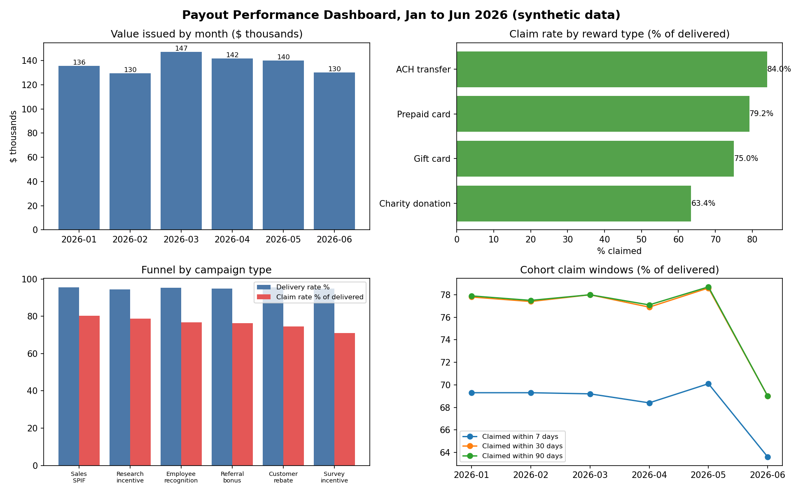

# Payout and Rewards Analytics

An end-to-end product analytics project on a fully synthetic dataset:
12,000 payouts worth $824,880, issued by 12 fictional companies from
January to June 2026. Built to show the work a senior data analyst
actually ships: a documented data model, sophisticated SQL, a defined
metrics layer, a dashboard, and findings written for decision makers.

No real data is used anywhere in this repository. The data generator
(`generate_data.py`) invents every company, recipient, and transaction,
with realistic patterns planted for the analysis to find.

## The questions

1. Is claim performance keeping up with payout volume?
2. Where do recipients drop off: delivery, or claiming?
3. Which reward types and denominations get claimed, and which get ignored?
4. Does the 72-hour reminder actually move claim rates?
5. Is any sender quietly losing payouts?

## Headline findings

All numbers come from the queries in `sql/` and are reproducible with
`run_analysis.py`. Definitions are in `metrics_definitions.md`.

**One sender's broken month explains the March dip.** Platform claim
rate held at 75 to 76% of issued payouts in January, February, April,
and May, then printed 67.1% in March. The cause was not recipient
behavior. Northwind Traders, the largest sender by value ($130,065,
15.8% of all value issued), failed to deliver 74.0% of its March
payouts (230 of 311) while every other sender-month stayed under 10%.
Its overall claim rate, 65.8%, sits 7.5 points below the average
sender. One delivery incident at one large sender moved the platform
number for a full month.

**The 72-hour reminder is associated with more than double the claim
rate.** Among payouts still unclaimed 72 hours after delivery, 48.9%
of reminded recipients eventually claimed, versus 20.7% of recipients
who were not reminded. Honest caveat: reminders were not randomized
in this data, so this is an association. The right next step is a
randomized holdout, and this dataset is structured to run one.

**Recipients claim money they can spend, and ignore money they cannot
feel.** Claim rate of delivered payouts by reward type: ACH transfer
84.0%, prepaid card 79.2%, gift card 75.0%, charity donation 63.4%.
Amount matters inside every type. Gift cards under $10 claimed at
61.7%; gift cards of $100 to $249 claimed at 81.2%. Small payouts are
the leak: they cost the same to send and a fifth more of them die
unclaimed.

**Claims are front-loaded, and the window closes fast.** In the
January cohort, 69.3% of delivered payouts were claimed within 7 days
and 77.8% within 30 days. By 90 days the number was 77.9%. Almost
nothing arrives after day 30, so every intervention (reminders,
support outreach, sender nudges) has to land inside the first month
to matter.

**Data quality checks pass.** Duplicate IDs, negative amounts,
claims without delivery, out-of-order timestamps, and unknown status
values all return zero problem rows (`sql/08_data_quality_checks.sql`).

## Recommendations a stakeholder can act on

1. **Alert on sender delivery health.** Page the team when any
   sender's monthly delivery failure rate crosses 10%. The March
   incident would have been caught in its first week.
2. **Keep the 72-hour reminder, and prove it.** The association is
   strong (48.9% vs 20.7%). Run a randomized holdout for one month
   to turn it into a causal number before expanding the program.
3. **Fix the small payout leak.** Review denominations under $10,
   especially gift cards. Consolidate them, raise minimums, or steer
   those campaigns to ACH, where claim rates are highest.
4. **Spend intervention budget inside 30 days.** After day 30 the
   claim curve is flat. Later outreach is spend without return.

## Dashboard



The four views (monthly value issued, claim rate by reward type,
funnel by campaign type, cohort claim windows) are specified for
Tableau in `tableau/tableau_workbook_spec.md`, with calculated fields
and filters, so the workbook can be rebuilt exactly in Tableau
Desktop or Tableau Public from `data/payouts.csv`.

## Repository layout

| Path | Contents |
| --- | --- |
| `generate_data.py` | Synthetic data generator, seeded for reproducibility |
| `data/payouts.csv` | The dataset (12,000 rows) |
| `data_dictionary.md` | Column-by-column documentation |
| `sql/` | Eight numbered analysis queries, each framed by a business question |
| `run_analysis.py` | Loads the CSV into SQLite, runs every query, writes results |
| `outputs/` | The result of every query, as CSV |
| `metrics_definitions.md` | The semantic layer: one definition per metric |
| `tableau/tableau_workbook_spec.md` | Sheet-by-sheet Tableau build spec |
| `make_charts.py` | Builds the dashboard preview image from the SQL outputs |
| `images/dashboard_preview.png` | Static dashboard preview |

## How to reproduce

```bash
python3 generate_data.py     # rebuilds data/payouts.csv (seeded, same output)
python3 run_analysis.py      # runs all SQL, writes outputs/
python3 make_charts.py       # rebuilds images/dashboard_preview.png
```

The SQL is written in SQLite dialect so it runs with no setup.
Dialect differences for a warehouse (date truncation, string
emptiness checks) are noted in the query headers.

## Reading the caveats like an analyst

- June 2026 reads low on claim metrics because the snapshot date is
  June 30: June payouts have not had their full claim window. It is a
  censoring artifact, not a performance drop. The cohort query
  (`sql/05_cohort_claim_windows.sql`) makes this visible.
- Two claim rates are used in this project, of issued and of
  delivered, and they are never mixed without labels. Definitions are
  in `metrics_definitions.md`.
- The reminder result is an association, not a causal claim. The
  README says so wherever the number appears.
